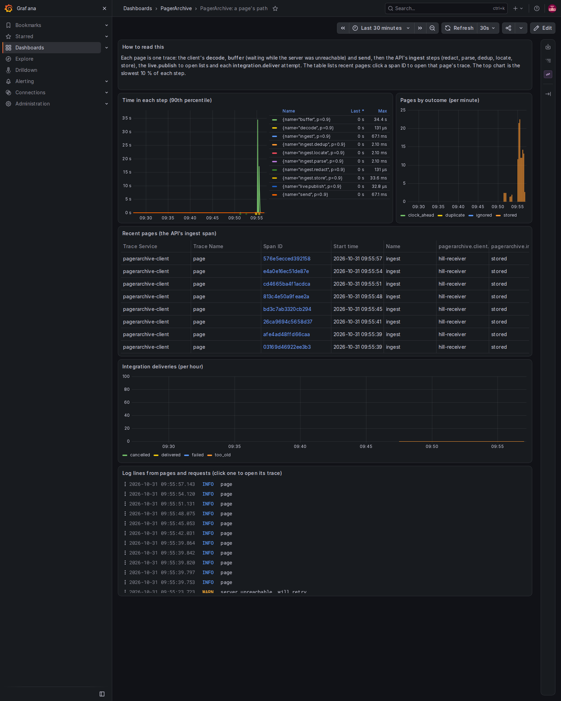
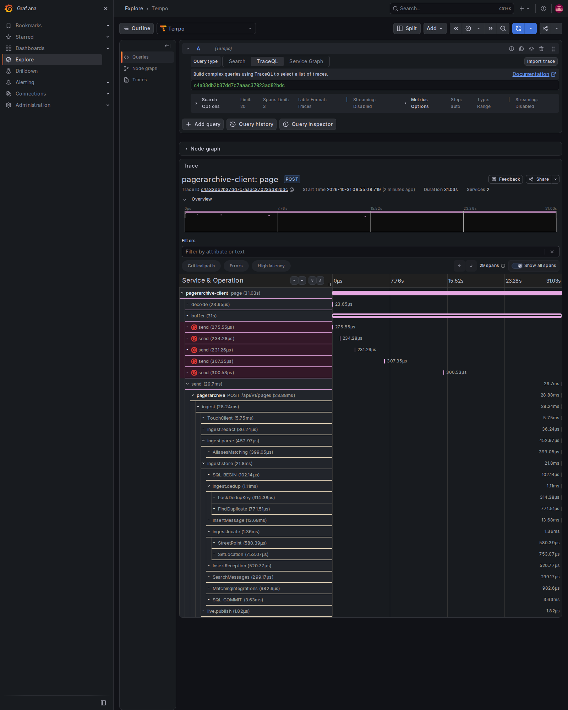
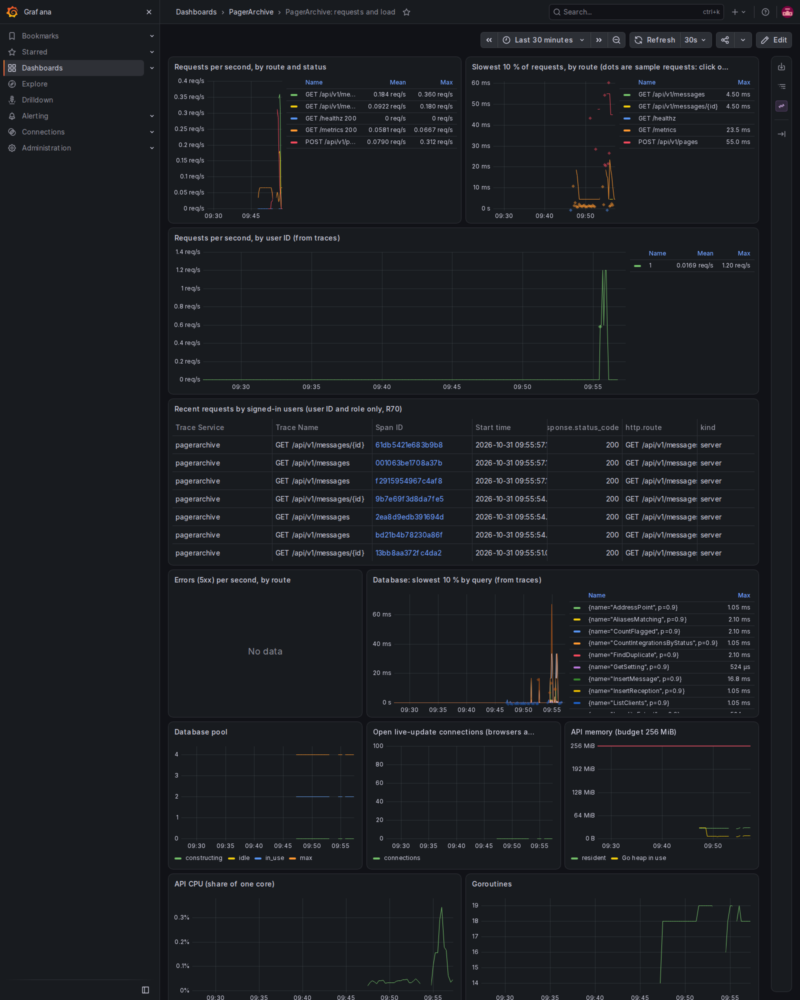
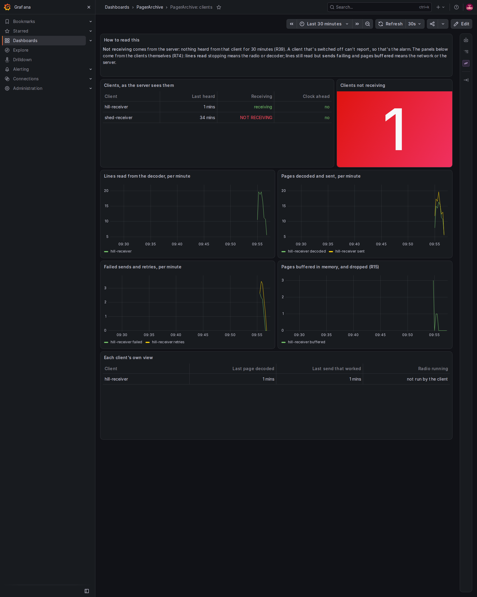
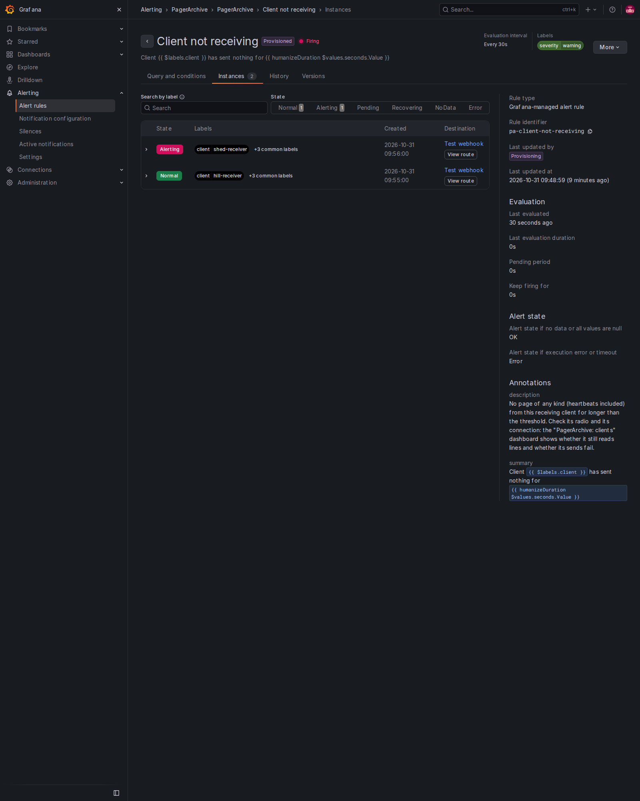

# Monitoring: telemetry and the example Grafana stack

PagerArchive can send **telemetry** (traces, logs and metrics) to a monitoring stack you run next to it, for troubleshooting: following one page from the receiver to the database, finding where time goes, tying high load to what users were doing, and being told when a receiver goes quiet. It's off until you turn it on, and PagerArchive itself never sends alerts (SPEC.md section 4); the monitoring stack does.

`deploy/monitoring` is a complete example stack: Grafana Alloy, Tempo, Loki, Prometheus and Grafana, with data sources, three dashboards and two alert rules already set up. This page explains what each part does, how to start it, how to point PagerArchive at it, and how to use it when something goes wrong. It assumes you know Docker and Docker Compose, but not this stack.

- [The parts](#the-parts)
- [What telemetry contains, and what it never does](#what-telemetry-contains-and-what-it-never-does)
- [Starting the stack](#starting-the-stack)
- [Pointing the API at it](#pointing-the-api-at-it)
- [Pointing a receiving client at it](#pointing-a-receiving-client-at-it)
- [The dashboards](#the-dashboards)
- [Alerts, and where they go](#alerts-and-where-they-go)
- [Your first incident](#your-first-incident)
- [Memory and disk](#memory-and-disk)
- [The OTEL settings](#the-otel-settings)
- [When something doesn't show up](#when-something-doesnt-show-up)
- [Upgrading the stack](#upgrading-the-stack)

## The parts

```
 receiving client ──OTLP──┐                    ┌──► Tempo ──────┐
                          ▼                    │   (traces)     │
 PagerArchive API ──OTLP──► Grafana Alloy ─────┼──► Loki ───────┼──► Grafana ──► you
        ▲                  (collects, keeps    │   (logs)       │   (dashboards,
        └─── /metrics ◄────  only what's       └──► Prometheus ─┘    alerts)
             (scraped)       allowed)              (metrics)
```

| Part | What it does | Do you talk to it? |
|---|---|---|
| **Grafana Alloy** | The collector. Receives traces, logs and metrics over OTLP (the OpenTelemetry protocol) from the API and clients, scrapes the API's `/metrics` every 15 s, drops any attribute it doesn't know (a second line of defence, see below), and passes each kind on to its store | No |
| **Tempo** | Stores **traces**: one trace per page or per request, made of **spans** (timed steps, like "parse" or "send") | Through Grafana |
| **Loki** | Stores **logs**: the same lines the API and clients print, each with the ID of the trace it belongs to | Through Grafana |
| **Prometheus** | Stores **metrics**: numbers over time, such as requests per second, memory, or when each client was last heard | Through Grafana |
| **Grafana** | The web interface: dashboards, searching traces and logs, and **alert rules** that notify you | Yes, it's the only part with a published port |

Some words you'll meet:

- **Trace / span.** A trace is everything that happened for one piece of work. Each step in it is a span with a start, a duration and a few attributes (a route, a status code). Spans nest: the API's request span contains its "ingest" span, which contains "parse", and so on.
- **OTLP.** The OpenTelemetry protocol. PagerArchive sends it over HTTP to port 4318.
- **Exemplar.** A sample request attached to a point on a metrics chart, so you can jump from "requests were slow at 14:05" to one of those slow requests' traces.
- **Contact point / notification policy.** In Grafana, where alerts are sent (email, Pushover, a webhook) and which alerts go where.

## What telemetry contains, and what it never does

Nothing exported contains page text, search terms or other query values, redacted details, tokens, cookies, client keys, secrets, email addresses or names (SPEC.md R70, P1). PagerArchive makes sure of that itself:

- **Every** span, log record and metric leaves through an **allowlist** in the app (`internal/telemetry/filter.go`): only listed attribute keys are kept, values are checked to be codes, numbers or IDs, and span names must be route patterns (`GET /api/v1/messages/{id}`), query names (`InsertMessage`) or known steps (`ingest.parse`). Anything else is dropped or renamed `unnamed`, whatever a library or a new line of code adds.
- Requests are named by their **route pattern**, never the real path or its query string. Database calls by the **query's name**, never its SQL or values. Errors by their **kind** (`SQLSTATE 23505`, `HTTP 503`), never their text.
- A signed-in request's span carries the user's **number and role**, nothing else about them. Spans for what users do never carry message, alias or job IDs; the one exception is the ingest span, which records the stored message's ID.
- The API continues a trace sent with a request (W3C `traceparent`) **only from a receiving client** with a valid key. Browser and PowerShell requests always start their own trace.
- The client's console page text (`PRINT_PAGES=true`) is never sent.

**Alloy's allowlist is the backup, not the rule.** `alloy/config.alloy` also drops attributes it doesn't know and every span event. If a future version slipped, that would still catch it, but the guarantee is the app's.

**Grafana access is for the deployment's admins.** Telemetry shows receiving clients' IDs (and so, possibly, where receivers are) and users' numeric IDs next to what they requested. Give Grafana accounts only to the people who are admins in PagerArchive. Anonymous access is off.

## Starting the stack

You need PagerArchive running from the compose file at the top of the repository (docs/deploy.md), with `METRICS_TOKEN` set in its `.env`.

1. Go to the stack's folder and make its settings file:

   ```sh
   cd deploy/monitoring
   cp .env.example .env
   ```

2. In `.env`, set:
   - `GRAFANA_ADMIN_PASSWORD`: a long password for Grafana's `admin` account;
   - `PA_METRICS_TOKEN`: the same value as `METRICS_TOKEN` in PagerArchive's `.env`;
   - `GRAFANA_BIND`: `127.0.0.1:3000` keeps Grafana on this machine; use the server's LAN address (`192.168.1.20:3000`) to open it from other computers. **Never publish it to the internet.**

   If you renamed PagerArchive's compose project, set `PAGERARCHIVE_NETWORK` to its network (`docker network ls` shows it: `<project>_default`).

3. Start it:

   ```sh
   docker compose up -d
   docker compose ps     # five services, all "running"
   ```

   The first start takes a few minutes: Grafana sets up its database.

4. Open Grafana (`http://localhost:3000`, or the address you chose) and sign in as `admin` with your password. **Dashboards → PagerArchive** has the three dashboards. The "client" panels fill in once Alloy has scraped the API (15 s). Traces and logs appear once you point the API at Alloy (next section).

Stop it with `docker compose down` (keeps the data) or `docker compose down -v` (deletes it).

The stack is **LAN-only**: Grafana's port is the only one published. Tempo, Loki and Prometheus sit on an internal Docker network with no way out, and nothing in the stack calls home (usage reports, update checks and plugin downloads are switched off).

## Pointing the API at it

In PagerArchive's `.env` (not the monitoring stack's), add:

```sh
OTEL_EXPORTER_OTLP_ENDPOINT=http://alloy:4318
```

and recreate the API: `docker compose up -d api`. The API reaches Alloy by name because the monitoring stack joined PagerArchive's network. Its log then says `telemetry on traces=true logs=true metrics=false`. Its metrics stay on `/metrics`, which Alloy scrapes (R75); they're never pushed.

To turn telemetry off again, remove the line (or set `OTEL_SDK_DISABLED=true`) and recreate the API.

## Pointing a receiving client at it

A client on the **same machine** as the monitoring stack (in Docker on PagerArchive's network) uses `http://alloy:4318` too. A client on **another machine** (the Raspberry Pi by the antenna) needs Alloy's OTLP port published on the LAN:

1. In the monitoring stack's `.env`, set `ALLOY_OTLP_BIND` to the server's LAN address and a port, e.g. `192.168.1.20:4318`.
2. Start the stack with the extra file: `docker compose -f compose.yaml -f compose.clients.yaml up -d`.
3. On the client, add to its settings:

   ```sh
   docker run ... \
     -e OTEL_EXPORTER_OTLP_ENDPOINT=http://192.168.1.20:4318 \
     -e OTEL_METRIC_EXPORT_INTERVAL=15000 \
     ghcr.io/rikiku/pagerarchive-client
   ```

   (For the binary on a Pi, put the same two lines in its systemd unit's `Environment=`.)

Anyone who can reach that port can send telemetry into your stack, so keep it on the LAN, or reach it over the same VPN the client uses for the server (docs/client.md).

The client sends its traces (each page from decode to the server's answer), its log lines and its metrics: lines read, pages decoded and sent, failed sends and retries, pages buffered and dropped, when it last decoded a page and last sent one, and whether the radio pipeline is running (R74). Its `service.instance.id`, and so the `instance` label on its metrics, is its client ID.

## The dashboards

All three are in **Dashboards → PagerArchive**. They're files (`grafana/dashboards/*.json`): edits made in Grafana don't stick; change the files, or save a copy under another name.

**A page's path.** Where time goes between a receiver decoding a page and it being stored, shown live and sent on: the slowest 10 % of each step (decode, buffer, send, the API's redact, parse, dedup, locate and store, the live update, each integration delivery), pages by outcome, a table of recent pages (click a span ID to open that page's trace), and the log lines from pages and requests (click one for its trace).



One page's trace, opened from that table. The client's `buffer` span is long because the API was unreachable for 20 s; the failed `send` attempts sit inside it, and the one that worked continues into the API's spans:



**Requests and load.** Requests per second by route and status, the slowest 10 % by route (the dots are exemplars: click one for that request's trace), requests by user ID from traces, errors, the slowest database queries, the database pool, open live-update connections, and the API's memory (with the 256 MiB budget line) and CPU.



**Clients.** Each client as the server sees it (last heard, receiving or not, clock ahead), and each client's own numbers. **Lines read** stopping means the radio or decoder has stopped; lines still read but **failed sends** climbing and pages **buffered** means the network or the server.



## Alerts, and where they go

Two alert rules come provisioned (`grafana/provisioning/alerting/rules.yaml`), in the **PagerArchive** folder of **Alerting → Alert rules**:

| Rule | Fires when | Clears when |
|---|---|---|
| **Client not receiving** | a client has sent no page of any kind (heartbeats included) for more than 30 minutes (R39). One alert per client | the client is heard again |
| **API unreachable** | Alloy's scrape of `/metrics` has failed for 30 s: the API is down, unreachable, or `METRICS_TOKEN` changed | the scrape works again |



**The threshold** for "Client not receiving" is the number in `params: [1800]` in `rules.yaml` (seconds). Change it and restart Grafana (`docker compose restart grafana`). It's in the file because Grafana doesn't fill in settings inside an alert rule's query.

**Where alerts go.** Out of the box, alerts go to Grafana's default contact point, which emails nobody until you set it up. Credentials stay in Grafana, never in the repository. In Grafana:

- **Pushover:** **Alerting → Contact points → + Add contact point**. Name it, choose **Integration: Pushover**, paste your Pushover **API token** (from an application you create at pushover.net) and **user key**, and **Test** it. Then **Alerting → Notification policies**, edit the **Default policy** and set its contact point to the new one.
- **Email:** Grafana needs a mail server first. Add to the `grafana` service's `environment` in `compose.yaml` (or a `compose.override.yaml` next to it): `GF_SMTP_ENABLED: "true"`, `GF_SMTP_HOST: smtp.example.org:587`, `GF_SMTP_USER`, `GF_SMTP_PASSWORD` (from `.env`, like the admin password) and `GF_SMTP_FROM_ADDRESS`, then `docker compose up -d grafana`. Then edit the contact point **grafana-default-email** (or add one) with your address and **Test** it.

Like integrations, these alerts are a convenience for you as the operator, not operational alerting (SPEC.md section 4).

## Your first incident

The shed receiver's antenna cable has worked loose. Here's how the stack tells you, and how you find out why.

1. **The alert.** Pushover says: *Client not receiving — Client shed-receiver has sent nothing for 31m*. The server hasn't heard anything from that client, heartbeats included, for over 30 minutes.
2. **Is it the radio or the network?** Open **PagerArchive: clients**. In "Each client's own view", the shed receiver's **Last page decoded** is 31 minutes ago, but **Last send that worked** is too, and **Radio running** says *running*. In "Lines read from the decoder", its line stops at the same time. The client is up and talking to the monitoring stack, so the network is fine; the decoder has stopped producing pages. That points at the radio: the antenna, the dongle or interference. (If instead lines were still being read and decoded, with **failed sends** climbing and pages **buffered**, the problem would be between the client and the server.)
3. **What happened just before?** Open **PagerArchive: a page's path**, and in "Recent pages" find the last page from `shed-receiver` (the `pagerarchive.client.id` column). Click its span ID to open its trace, which shows the client's decode, buffer and send, then the API's steps. All normal: the last page arrived fine.
4. **The logs around it.** In the trace view, a span's **Logs for this span** button opens Loki with that trace's log lines; or in **Explore**, choose **Loki** and run `{service_name="pagerarchive-client", service_instance_id="shed-receiver"}`. Nothing but "page" lines, then silence: no errors from the client itself.
5. **Fix and confirm.** You reseat the cable. Within a minute the client decodes a heartbeat, the server hears it, and the alert sends *Resolved*.

The same steps work the other way round. Slow pages? **A page's path** shows which step is slow, and the trace shows whether it was the database (an `InsertMessage` span), geocoding (`ingest.locate`) or a slow integration endpoint (`integration.deliver`). High load? **Requests and load** shows which route and which user ID; click an exemplar dot for a slow request's trace, and from there its log lines.

## Memory and disk

Measured on the test machine (`scripts/monitoring-checks.sh`, two runs on 2026-10-30), as Docker reports each container's memory, sampled every 10 s. "Idle" is the first 2 minutes after starting; "during A65" is the alert check (clients posting, the API stopped and started); "viewing dashboards" is while test data was fed in and the screenshots on this page were taken, which runs TraceQL queries in Tempo:

| Container | Idle | During A65 | Viewing dashboards |
|---|---|---|---|
| Grafana | 372–552 MiB | 353–578 MiB | 574–786 MiB |
| Tempo | 58–75 MiB | 108–111 MiB | 188–224 MiB |
| Loki | 52–75 MiB | 56–76 MiB | 63–121 MiB |
| Alloy | 50–52 MiB | 49–51 MiB | 50–109 MiB |
| Prometheus | 40–44 MiB | 42–46 MiB | 85–94 MiB |
| **All five** (sum of each one's peak) | **618–752 MiB** | **638–832 MiB** | **960–1,334 MiB** |

Grafana is most of it, and varies most between runs. Plan on about 1 GB, more while someone has dashboards open. (These runs used Tempo 2.10.10. Tempo 3.1.1, now in `compose.yaml`, used about a quarter as much idle: 34 MiB against 127 MiB, measured side by side with nothing else running.)

The stack isn't counted in PagerArchive's resource budget (like Authentik). On disk, traces and logs are kept 7 days (`tempo/tempo.yaml`'s `block_retention`, `loki/loki.yaml`'s `retention_period`) and metrics 30 days (`METRICS_RETENTION` in `.env`). At hobby scale (about a page a minute) that's well under a gigabyte.

## The OTEL settings

PagerArchive uses the standard OpenTelemetry environment variables. The ones you're likely to need:

| Variable | Meaning |
|---|---|
| `OTEL_EXPORTER_OTLP_ENDPOINT` | Where to send everything, e.g. `http://alloy:4318`. **Unset: telemetry is off**, nothing is sent and nothing tries to connect |
| `OTEL_EXPORTER_OTLP_TRACES_ENDPOINT`, `..._LOGS_ENDPOINT`, `..._METRICS_ENDPOINT` | One signal somewhere else (the full URL, ending `/v1/traces` and so on) |
| `OTEL_SDK_DISABLED=true` | Everything off, whatever else is set |
| `OTEL_TRACES_EXPORTER`, `OTEL_LOGS_EXPORTER`, `OTEL_METRICS_EXPORTER` | `none` turns that signal off; `otlp` (the default) is the only other choice |
| `OTEL_EXPORTER_OTLP_PROTOCOL` | `http/protobuf` (the default) or `http/json`. `grpc` isn't supported: that signal stays off and the log says so |
| `OTEL_SERVICE_NAME` | Defaults to `pagerarchive` and `pagerarchive-client` |
| `OTEL_RESOURCE_ATTRIBUTES` | Extra labels, e.g. `deployment.environment.name=home`. Only standard keys are kept: `service.*`, `deployment.environment(.name)`, `host.name`, `host.arch` |
| `OTEL_TRACES_SAMPLER`, `OTEL_TRACES_SAMPLER_ARG` | Every trace is kept by default; e.g. `parentbased_traceidratio` with `0.1` keeps one in ten |
| `OTEL_EXPORTER_OTLP_TIMEOUT` | How long one export may take, in ms (default 10000). A batch that doesn't make it is dropped |
| `OTEL_EXPORTER_OTLP_HEADERS` | Headers for a collector that wants them (`Authorization=Bearer ...`) |
| `OTEL_BSP_*`, `OTEL_BLRP_*`, `OTEL_METRIC_EXPORT_INTERVAL` | Batching and how often the client sends its metrics (default 60000 ms) |

Trace context travels as W3C `traceparent` only; `OTEL_PROPAGATORS` is ignored and baggage is never read or sent, because it could carry anything into a span.

**When the collector is down or slow**, nothing waits for it: spans and log lines go into bounded queues and are sent in batches in the background, and a batch the collector doesn't take in time is dropped. The API and client say so in their own log at most once a minute: `telemetry: the collector isn't taking data; dropping telemetry (said at most once a minute)`, with how many items were dropped. Pages, requests and deliveries are never delayed or lost because of it (R69, A64).

## When something doesn't show up

- **No data at all in the client panels or "up" alerts firing:** Alloy can't scrape the API. Check `PA_METRICS_TOKEN` matches the API's `METRICS_TOKEN`, and `docker compose logs alloy`. `PAGERARCHIVE_NETWORK` must be PagerArchive's network.
- **Metrics but no traces or logs:** `OTEL_EXPORTER_OTLP_ENDPOINT` isn't set on the API (after adding it, `docker compose up -d api` recreates the API with it). The API's log says `telemetry on` when it's set.
- **The API's log says "dropping telemetry":** it can't reach Alloy. Is the monitoring stack running? `docker compose ps` in `deploy/monitoring`.
- **No client metrics:** the client needs `OTEL_EXPORTER_OTLP_ENDPOINT`, and a client on another machine needs `compose.clients.yaml` and a reachable `ALLOY_OTLP_BIND`. It sends metrics every `OTEL_METRIC_EXPORT_INTERVAL` (default a minute).
- **Tempo logs `error calling scheduler` … `no jobs found`** about once a minute: its background worker asking for compaction or retention work when there is none. It's harmless.
- **A trace from the last 30 seconds isn't found yet:** Tempo 3 leaves the newest 30 s out of searches (`query_end_cutoff`) while it's still being written. Wait a moment and search again.
- **A span named `unnamed`:** the app saw a span name that isn't on its allowlist. Report it: it's a bug, and nothing private left with it.

## Upgrading the stack

Each image is pinned by version and digest in `compose.yaml` (`grafana/grafana:13.2.5@sha256:...`), so `docker compose pull` never changes anything by surprise. To upgrade, change both the version and the digest (`docker buildx imagetools inspect grafana/grafana:<version>` shows the digest), read the release notes, and run `scripts/monitoring-checks.sh`, which checks the alerts end to end.
